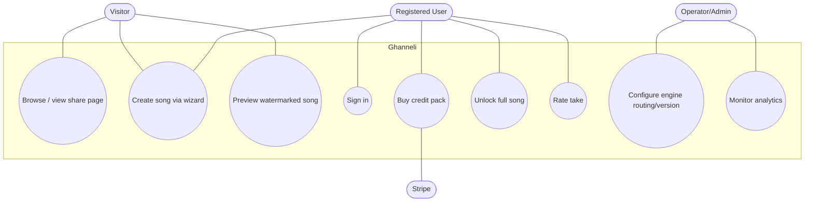
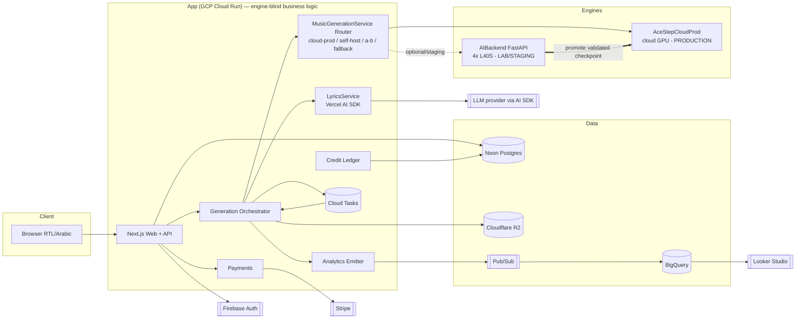
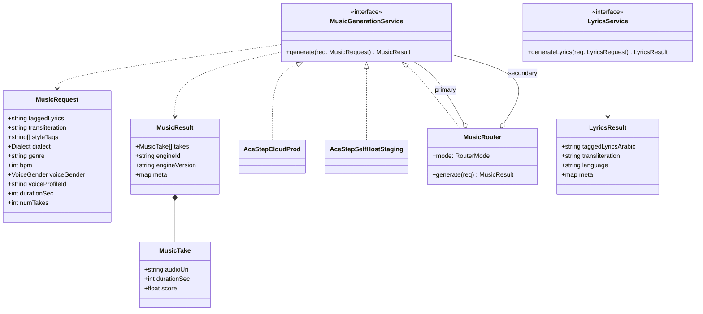
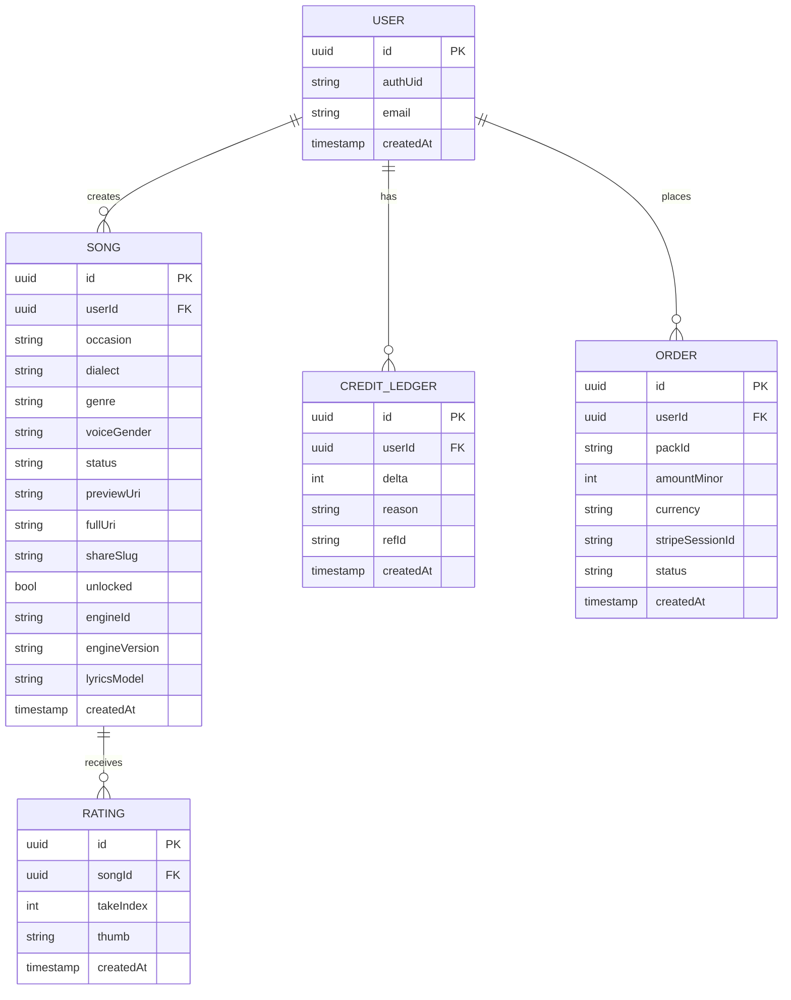
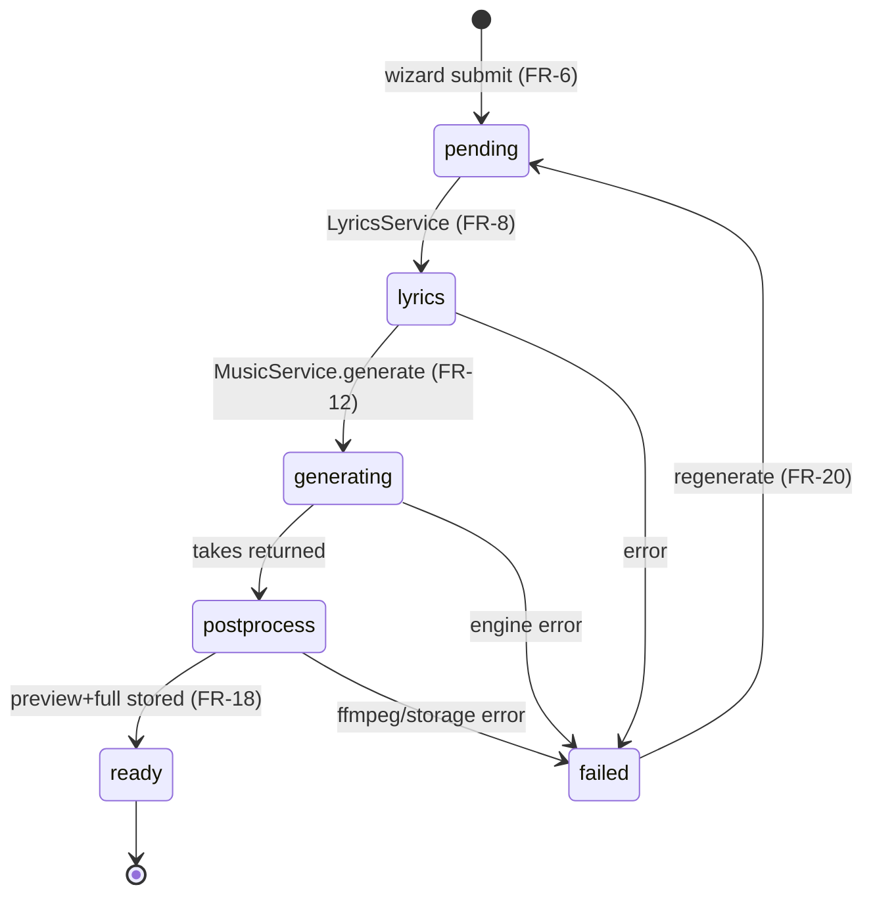
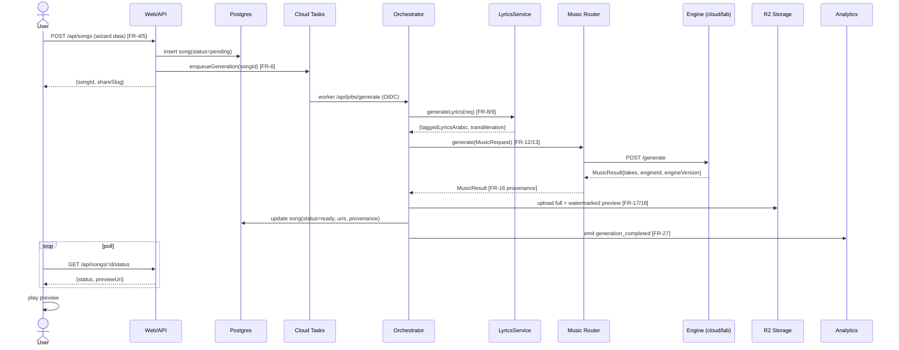
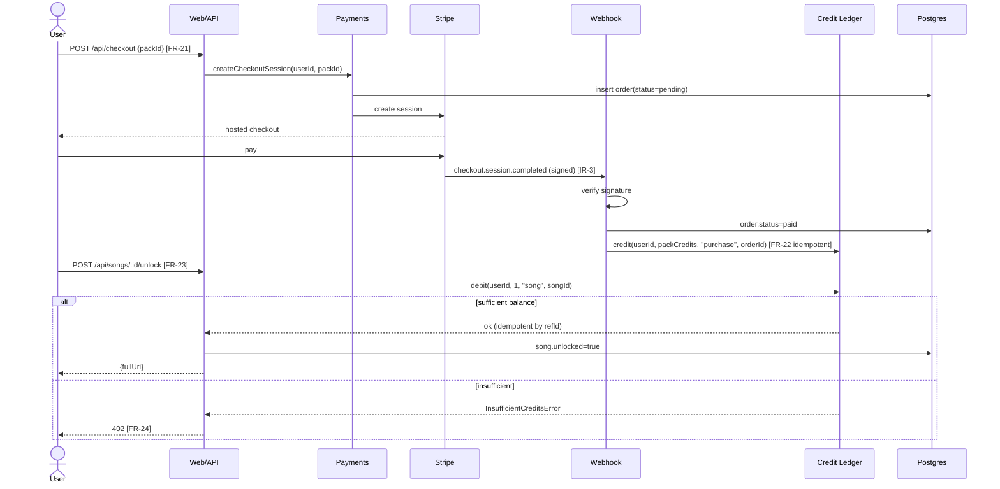
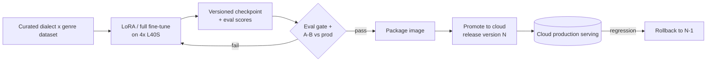
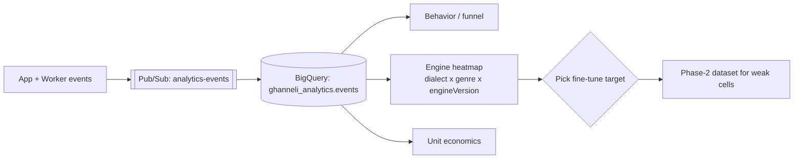

# Ghanneli — UML & Architecture Diagrams (Mermaid)

**Version:** 1.0 (MVP) · **Date:** 2026-06-27
**References:** `docs/requirements/SRS.md`, `docs/superpowers/specs/2026-06-27-ghanneli-design.md`, `docs/superpowers/plans/2026-06-27-ghanneli-mvp.md`.

These diagrams are the visual reference design for the MVP. They are normative for structure; requirement IDs (FR/NFR/DR) trace to the SRS.

---

## 1. Use-case diagram

---

## 2. Container / component diagram (two-part architecture)

---

## 3. Class / interface diagram (engine & lyrics abstractions)

---

## 4. Entity-relationship diagram (data model)

---

## 5. Song lifecycle (state diagram)

---

## 6. Sequence — generate a song (async)

---

## 7. Sequence — buy credits & unlock full song

---

## 8. Model release pipeline (Phase 2 — fine-tune → promote)

---

## 9. Analytics flywheel (data → decision)

